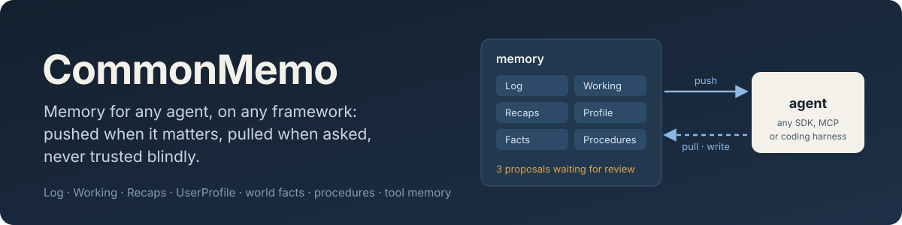
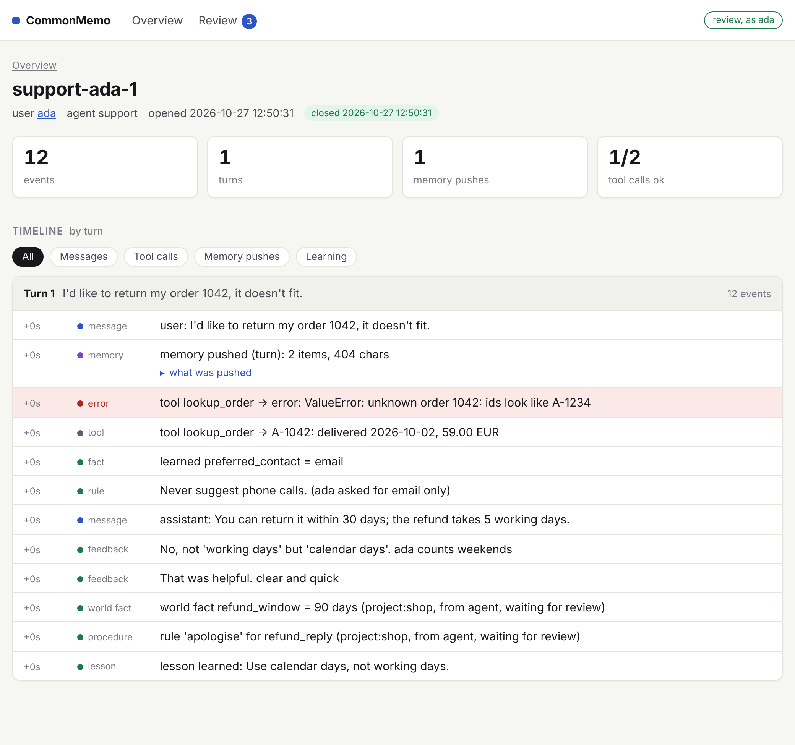
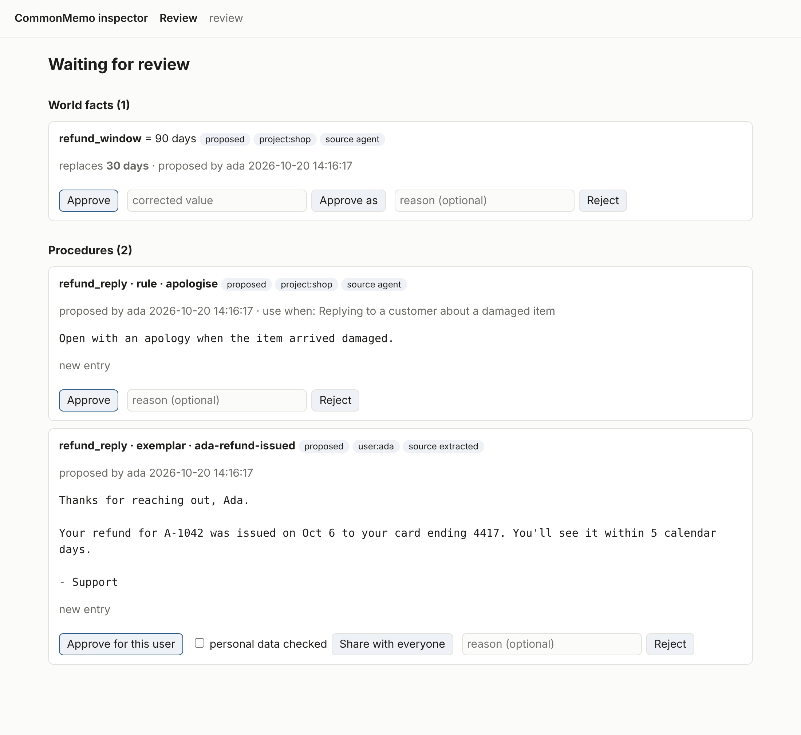
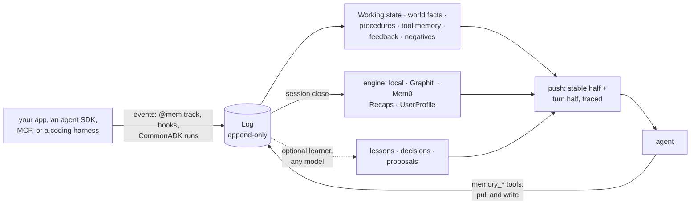

<p align="center">
  
</p>

**Memory for agents that works the same on every framework, and that you
can audit, correct and roll back.**

Agents forget everything between sessions, and the memory bolted onto them
is usually a vector store that anything can write to and nobody can
inspect. CommonMemo is one `Memory` handle in front of an append-only Log.
It decides what goes into each turn and records why. Agent and
model-learned writes wait for an operator's approval before they reach
anyone else. Every change can be traced back to the events behind it, and
undone. It runs the same under Google ADK, OpenAI Agents, Claude Agent SDK,
CrewAI, AutoGen and LangGraph (through [CommonADK](https://github.com/Mehul-Gupta-SMH/CommonADK)),
over MCP, and inside Claude Code, Codex and OpenCode through their hooks.

[](https://github.com/Mehul-Gupta-SMH/CommonMemO/actions/workflows/ci.yml)
[](LICENSE)

<p align="center">
  
  
</p>

Real pages, from [`scripts/demo_memory.py`](scripts/demo_memory.py) (offline, no keys). Left: one turn's
push, item by item: a user's constraint, their profile, the project's facts,
a lesson learned from an earlier correction, the matched procedure, an
earlier session's recap, each with a **why** link to the events it came from.
Right: what waits for review, beside what it would replace.

---

## Quickstart

```bash
git clone https://github.com/Mehul-Gupta-SMH/CommonMemO.git && cd CommonMemO
pip install -e .                      # core: stdlib only, offline local engine

# Build a small memory to look at: sessions, facts, procedures, a learned lesson.
python scripts/demo_memory.py demo.db

# Open it in the browser: turn traces, users, and the review queue.
commonmemo inspect --store sqlite:///demo.db --project shop --review --open

# The same from a terminal: what one turn was given, and why.
commonmemo trace support-ada-2 --store sqlite:///demo.db
commonmemo trace support-ada-2 --why refund_reply/rule/timeline --store sqlite:///demo.db

# Does memory change what an agent does? 19 scenarios, with and without it.
python -m evals

# Give Claude Code memory: print the hooks config to merge into .claude/settings.json.
commonmemo setup claude-code --user ada
```

Nothing above needs an API key or spends money. CommonMemo isn't on PyPI yet
([#12](https://github.com/Mehul-Gupta-SMH/CommonMemO/issues/12)); once it is:

```bash
pip install commonmemo                 # core: stdlib only, local engine
pip install "commonmemo[commonadk]"    # + CommonADK integration
pip install "commonmemo[graphiti]"     # + Graphiti engine (temporal knowledge graph)
pip install "commonmemo[mem0]"         # + Mem0 engine (LLM-extracted user memories)
pip install "commonmemo[postgres]"     # + Postgres for everything CommonMemo stores
pip install "commonmemo[mcp]"          # + the official MCP client, for testing the server
pip install "commonmemo[otel]"         # + turn traces as OpenTelemetry spans
```

## How it works



Everything starts as an event in the **Log**, which is never edited. The
rest is derived from it and can be rebuilt from it:

| Tier | Holds | Owned by |
|---|---|---|
| **Log** | everything that happened, in order: messages, tool calls, your domain events | CommonMemo (SQLite or Postgres) |
| **Working** | what the current conversation or workflow run has in hand: live state and resume points, resumable by id | CommonMemo (SQLite or Postgres) |
| **Recaps** | short summaries of finished sessions, retrieved by relevance | a wrapped engine |
| **UserProfile** | durable facts about one user; a newer value supersedes, history is kept | a wrapped engine |

Beside the tiers, CommonMemo keeps **structured kinds** itself:
- **tool memory:** which tools fail, how, and what fixed it; never the users' data;
- **world facts:** with lifetimes; an agent's are proposals until approved;
- **procedures:** templates, rules, steps and accepted examples, per task type;
- **feedback:** ratings and corrections;
- **negatives:** "never do X", plus tombstones for "forget this";
- **resume points:** checkpoints and replayable steps.

Agents use memory in **hybrid** mode. A bounded part is *pushed* each turn:
- a **stable half** for the agent's instructions, which rarely changes, so
  prompt caching keeps working;
- a **turn half** with the request;
- **tool notes**, in the tools' own descriptions.

Agents *pull* the rest, and write, through the `memory_*` tools. Everything
pushed is framed as reference data, not instructions, and every push is
recorded as a **turn trace**.

CommonMemo **wraps** memory engines rather than building one. Extraction and
retrieval belong to engines that specialize in them (Graphiti and Mem0). The
built-in `local` engine is offline and deterministic, so everything works out
of the box and in tests.

**Trust** is decided by source, not recency ([ADR 0002](docs/adr/0002-world-fact-trust.md)).
What an operator or your code writes takes effect at once. What an agent or
a learner writes for everyone waits in the review queue. A less trusted
write never silently replaces a more trusted one; it is kept as *disputed*.

## Use

```python
from commonmemo import Memory, MemoryEvent

mem = Memory("sqlite:///mem.db", project="shop")   # one path is the whole setup

# 1. Decorator: every call becomes an event (arguments, result/error, duration)
@mem.track
def lookup_order(order_id: str) -> str: ...

# 2. Subclass: your own domain events -- no @dataclass needed
class TicketOpened(MemoryEvent):
    ticket: str

# 3. Session: everything else is automatic
async with mem.session(user_id="u1", agent="support") as s:
    ctx = await s.context("where is my refund?")   # what memory pushes this turn
    s.message("user", "where is my refund?")
    lookup_order("42")                              # recorded into this session; feeds tool memory
    s.record(TicketOpened(ticket="T-9"))
    s.state["ticket"] = "T-9"                       # working memory, persisted
    s.remember("preferred_contact", "email")        # explicit user fact
    s.learn("refund_window", "30 days")             # world fact (ttl= for ones that go stale)
    s.feedback(-1, "too long")                      # rating / comment
    s.correct("Pune", "Bangalore")                  # correction
    s.never("suggest phone calls")                  # standing constraint
    s.forget("old_address")                         # tombstone: stays forgotten
    tools = mem.agent_tools(s)                      # memory_recall, memory_remember, ... for an agent
# on exit: the session's events are consolidated into a recap and UserProfile facts
```

`ctx.stable_text()` is meant for an agent's instructions and
`ctx.turn_text()` for the turn's request (`ctx.render()` gives both).
`mem.tool_notes(agent)` gives tool memory's advice per tool, and
`mem.tool_profile(tool)` the numbers behind it.

## On Postgres

SQLite is the default: one file, nothing to run. For memory that several
processes or machines share, give it a Postgres URL instead
([ADR 0001](docs/adr/0001-storage.md), [#11](https://github.com/Mehul-Gupta-SMH/CommonMemO/issues/11)):

```python
mem = Memory("postgresql://app@db.internal:5432/agents?schema=shop", project="shop")
```

```bash
export COMMONMEMO_STORE=postgresql://app@db.internal:5432/agents?schema=shop   # for the CLI, MCP server and hooks
```

The URL holds everything CommonMemo keeps itself: the Log, sessions, the
projections and the local engine's recaps. `?schema=` keeps one memory in
its own schema, so a database can hold several. Writes to the Log go one
at a time, under a transaction-scoped advisory lock, so log positions
commit in order. That way a process catching up never skips an event
another process committed. The whole test suite runs on Postgres in CI,
including writers in four processes against one reader.

## Ranking by meaning

One ranker decides which of a user's 50 facts go in the push, which world
facts a request is about, and what `memory_recall` returns
([#21](https://github.com/Mehul-Gupta-SMH/CommonMemO/issues/21)). By default
it matches words, stemmed and without stop words. Give it an embedder and it
matches meaning, so "How do I reach them?" finds `preferred_contact: email`:

```python
from commonmemo import EmbeddingRanker

mem = Memory(ranker=EmbeddingRanker(my_embed))   # any texts -> vectors function, sync or async
```

The Graphiti and Mem0 engines bring their own embedder, which ranks facts
too, with no setup. Embeddings are cached, and a profile small enough to
push whole is never ranked.

## World facts as configuration

```python
from commonmemo import FactKey

mem = Memory(project="shop", fact_keys=[
    FactKey("refund_window", "How long customers have to return an order", lifetime="90d", pinned=True),
    FactKey("plan_tier", "The customer's plan", allowed=("free", "pro")),
])
mem.load_facts("facts.yaml")     # keys and values, versioned with the app; loading again writes nothing new
```

The registry is optional ([#24](https://github.com/Mehul-Gupta-SMH/CommonMemO/issues/24)). With one:
- agents are shown the keys to reuse;
- an agent's write to an unregistered or near-duplicate key (`refund_period`)
  stays a proposal for review;
- registered lifetimes make facts go stale by default;
- pinned facts are always pushed; the rest only when the request is about
  them, so hundreds of facts don't crowd the prompt.

**The environment, detected** ([#57](https://github.com/Mehul-Gupta-SMH/CommonMemO/issues/57)). Agents guess the Python version and
library versions when nobody says. `mem.detect_environment(".")` records
them as `env.*` world facts, and the harness hooks do it at every session
start:

```
- env.python: 3.12.4 (requires >=3.11) (as of 2026-10-23, tool result, time-sensitive)
- env.os: Linux 6.8.0 (x86_64) (as of 2026-10-23, tool result, time-sensitive)
- env.python_packages: httpx 0.27.2, pydantic 1.10.13 (installed 1.10.9) (as of 2026-10-23, tool result, time-sensitive)
```

Versions come from `pyproject.toml` / `requirements*.txt`, at the version
locked in `uv.lock` or `poetry.lock`, plus the installed one where it
differs, and the same for `package.json`. They are direct dependencies only,
pinned in the stable half, and trusted as tool results, so an agent's guess
doesn't replace them. They refresh when they change or go stale. Environment
variables are never read.

## How a task is done: procedural memory

Templates, rules, step-by-step procedures and accepted examples, per task
type ([#26](https://github.com/Mehul-Gupta-SMH/CommonMemO/issues/26), [ADR 0003](docs/adr/0003-procedural-memory.md)). Write them as files next to your code:

```markdown
<!-- procedures/weekly_report/default.md -->
---
kind: template
use_when: Writing the weekly status report for the team
---
## Highlights
## Risks
## Next week
```

```python
mem.load_procedures("procedures/")        # current at once; a changed file is a new version
async with mem.session(user_id="ada", task="weekly_report") as s:   # or leave task out: matched by use_when
    ctx = await s.push_turn(prompt)       # rules, templates and step names, in the turn half
mem.procedure_outcomes("weekly_report")   # runs, feedback and skipped steps, per version
```

When the app doesn't name the task, the request is matched against the
`use_when` lines with the same ranker as facts. Agents get two tools:
- `memory_get_procedure` returns the full steps and examples;
- `memory_save_procedure` saves an entry. For the agent's own user it
  applies at once; for everyone, it is a proposal an operator approves.

Accepted examples (`s.save_exemplar(...)`) are the user's data. No one else
sees one until an operator shares it with `confirm_procedure(id, scrubbed=True)`,
and `forget_user` removes them.

### Learning from runs

Off by default. Give memory any model, as a function from a prompt to text.
Each finished session is then distilled into:
- decision records;
- lessons, merged when they repeat and pushed to the same user;
- proposed procedures, rules and example candidates, which wait for review.

```python
from commonmemo import ModelLearner

mem = Memory(learner=ModelLearner(lambda prompt: my_model(prompt)))   # sync or async
await mem.distill(session_id)              # or run it later, in a batch
mem.revert(run_id=f"learn:{session_id}")   # undo what one session taught
```

The learner sees messages, tool calls, feedback and step results, with
forgotten text redacted. It never sees raw reasoning.

### Facts from what was said

The local engine keeps a one-line digest of each session, and recall doesn't
search the Log's messages, so what a user said once is out of reach unless
someone wrote it down. Give memory a model and it extracts the durable facts
as each session closes ([#60](https://github.com/Mehul-Gupta-SMH/CommonMemO/issues/60); off by default, any prompt-to-text function):

```python
from commonmemo import ModelExtractor

mem = Memory(extractor=ModelExtractor(lambda prompt: my_model(prompt)))
with mem.session("s1", user_id="ada") as s:
    s.message("user", "My sister Lena arrives on Friday 14 November.")
# next session: "sister_arrival: Lena arrives on Friday 14 November" is in ada's pushed facts
await mem.extract(session_id)              # or run it later, in a batch
```

They are `UserFact`s with `source="extracted"` in that user's profile, so
they are ranked by the request, found by `memory_recall`, and removed by
`forget_user`. Text the user asked to forget is redacted before the model
sees it, and a fact quoting it is dropped. Extraction runs once per session,
and a failing model never fails the close. On a LoCoMo conversation it is the
difference between 23 and 38 correct answers out of 48
([docs/live-runs.md](docs/live-runs.md)).

### What was said

Recaps and facts are what memory made of earlier sessions. Memory can also
search the messages themselves ([#62](https://github.com/Mehul-Gupta-SMH/CommonMemO/issues/62); off by default, since it puts the user's
own earlier words into the prompt):

```python
mem = Memory(policy=MemoryPolicy(messages=8, recall_messages=8))
# the turn's push gets the 8 windows of past messages the request is about, and
# memory_recall returns 8 more: "[said] [session s1, 2026-10-24]  user: The guest room key is under the blue pot..."
```

Windows are 6 consecutive messages of one of the user's other sessions, ranked
by the same ranker as everything else (shared words, or meaning with an
embedder), and carry the ids of their events, so traces, `why` and the
inspector show where they came from. Only that user's messages, never the
current session's, never another user's; a session without a user has none;
forgotten text is redacted and `forget_user` removes the messages. The hook
and MCP commands take `--messages N` and `--recall-messages N`
(`COMMONMEMO_MESSAGES`, `COMMONMEMO_RECALL_MESSAGES`). The latest 4,000
messages are windowed on each call: an index is the next step.

## Resume a stopped process

```python
@mem.step                                  # finished calls replay on a rerun
def fetch(order_id: str) -> dict: ...

@mem.step(side_effects=True)               # never silently run twice
def refund(order_id: str) -> str: ...

with mem.session("job-42") as s:           # same id in a new process = resume
    order = fetch("A1")
    s.checkpoint("fetched", {"order": "A1"})
    refund("A1")
```

Rerunning the same code after a crash skips what finished and continues at
the first step that didn't. A side-effecting step interrupted mid-way raises
`StepInDoubt` instead of repeating itself. Side-effecting steps are claimed
before they run, so even several workers resuming one session at once run
each of them at most once; the others get `StepInProgress` while the
winner's lease is live.

## See how memory changes, and undo it

```python
with mem.run("deploy-42"):                  # tags everything written inside
    mem.learn("refund_window", "30 days")

mem.snapshot("before v3")
h = mem.history()
h.velocity(bucket=3600)                     # writes per hour, by kind/source/scope
h.churn(); h.review_flow(); h.by_run("deploy-42")
mem.as_of("before v3").world_facts()        # memory as it was then
mem.diff("before v3")                       # what changed since

mem.revert(to="before v3")                  # world facts, negatives and procedures back to a snapshot
mem.revert(run_id="commonadk:r-8812")       # undo one run; later edits by others survive
mem.freeze(source="agent")                  # agent world-fact writes become proposals
mem.alerts()                                # velocity spikes, churn, review backlog
```

Reverts append compensating events and never delete, so they can be undone
too. Alerts are on by default and logged to `commonmemo.alerts` ([#27](https://github.com/Mehul-Gupta-SMH/CommonMemO/issues/27), [ADR 0004](docs/adr/0004-history-analytics-and-reversion.md)).

## See what memory did

Every push into an agent's context is recorded as a **turn trace**. It
records what was pushed (by reference), where each item came from, and what
was left out. The pushed text itself is kept only with
`MemoryPolicy(trace_text=True)`, and `forget_user` removes a user's traces.

```bash
commonmemo trace s2 --why refund_window   # why the agent got it: the events it came from
commonmemo show user ada                  # profile, constraints, what was forgotten, past sessions
commonmemo inspect --open                 # the same, in a local read-only web page
commonmemo inspect --review               # also approve and reject what waits for review
```

```python
mem.traces(session_id="s2"); mem.why("refund_window", session_id="s2")
from commonmemo.otel import instrument; instrument(mem)   # pushes as OpenTelemetry spans
```

The inspector binds to 127.0.0.1 and runs no scripts. With `--review`, each
approval is a form post carrying a token from that server start, checked
against its own Host and Origin, and tagged `run_id="review:<reviewer>"`,
so a review session can be reverted ([#45](https://github.com/Mehul-Gupta-SMH/CommonMemO/issues/45)).
More in [docs/seeing-what-memory-did.md](docs/seeing-what-memory-did.md) ([#25](https://github.com/Mehul-Gupta-SMH/CommonMemO/issues/25)).

## With Graphiti

```python
from graphiti_core import Graphiti
from commonmemo.engines.graphiti import GraphitiEngine

mem = Memory("sqlite:///mem.db", engine=GraphitiEngine(graphiti=Graphiti(uri, user, password)))
# or Memory("sqlite:///mem.db", engine="graphiti") with NEO4J_URI / NEO4J_USER / NEO4J_PASSWORD set
```

Each closed session becomes one Graphiti episode in the user's graph
partition. Retrieval ranks past sessions by the graph facts that match, and
extracted facts join the user's explicit ones.

## With Mem0

```python
from commonmemo.engines.mem0 import Mem0Engine

mem = Memory("sqlite:///mem.db", engine=Mem0Engine(config={...}))  # Mem0's own config dict
# or Memory("sqlite:///mem.db", engine="mem0") for Mem0's defaults (OpenAI)
```

Each closed session is handed to Mem0, which extracts and updates the
user's memories. They join the user's explicit facts, and retrieval ranks
past sessions by the memories that match.

## With CommonADK

CommonADK normalizes all six of its targets (Google ADK, OpenAI Agents,
Claude Agent SDK, CrewAI, AutoGen, LangGraph) into one event stream, so one
hook gives every target the same memory:

```python
from commonmemo.integrations.commonadk import run_with_memory

async with mem.session(user_id="u1", agent="coordinator") as s:
    trace = await run_with_memory(s, runner, project, "coordinator", prompt)
```

Each turn, on a copy of the project (CommonADK itself is never changed):

- **capture:** every CommonADK event is recorded, and tool calls feed tool memory;
- **pull:** the memory tools are added to the agent, and tool memory's notes are
  written into the agent's own tools' descriptions;
- **push:** memory goes in front of the prompt, the only place released
  CommonADK can take it. Putting stable memory in the agent's instructions
  instead is requested in [CommonADK #30](https://github.com/Mehul-Gupta-SMH/CommonADK/issues/30);
  `run_with_memory` uses it automatically if a runner supports it ([#7](https://github.com/Mehul-Gupta-SMH/CommonMemO/issues/7)).

## As an MCP server (Claude Code, Codex, any MCP client)

`commonmemo mcp` serves the memory tools to MCP clients over stdio, bound to
one session. It needs nothing beyond the core. For Claude Code, add it to
the project's `.mcp.json`:

```json
{
  "mcpServers": {
    "memory": {
      "command": "commonmemo",
      "args": ["mcp", "--user", "ada", "--agent", "claude-code"],
      "env": { "COMMONMEMO_STORE": "sqlite:///.commonmemo/memory.db" }
    }
  }
}
```

- **Tools:** `memory_recall`, `memory_get_procedure` (when procedures exist),
  `memory_remember`, `memory_note_fact`, `memory_avoid`,
  `memory_save_progress` and `memory_save_procedure`. With `--read-only`, only
  the first two. Writes are recorded with `source="agent"`, and an agent's
  world facts are proposals until approved, as in Python.
- **Push:** the server's instructions carry the stable memory (negatives,
  profile, world facts, lessons); the resource `memory://context` has all of it.
- **Config:** `--store`, `--engine`, `--project`, `--user`, `--agent`,
  `--session`, `--read-only`, or the same as `COMMONMEMO_*` environment
  variables. The same `--session` from another harness continues the
  session; another user's session is refused. Closing the client closes and
  consolidates the session.

The model decides when to call a tool, so MCP alone doesn't capture every
event; the hooks below do. Tested over real stdio, and against the official
MCP client ([#4](https://github.com/Mehul-Gupta-SMH/CommonMemO/issues/4)).

## Hooks: automatic capture and push in coding harnesses

With hooks, the harness itself hands memory every prompt, tool call and
reply, and puts memory in front of the session and of each prompt. Nothing
depends on the model calling a tool. `commonmemo setup <harness>` prints
the config; every event runs `commonmemo hook`, which reads the event's JSON
on stdin.

**Claude Code:** merge the output into `.claude/settings.json`:

```bash
commonmemo setup claude-code --user ada
```

```jsonc
{
  "hooks": {
    "SessionStart": [{ "hooks": [{ "type": "command", "command": "commonmemo hook --harness claude-code --user ada" }] }],
    // the same entry for UserPromptSubmit, PostToolUse, PostToolUseFailure, Stop, PreCompact and SessionEnd
  }
}
```

**Codex:** merge `commonmemo setup codex --user ada` into `.codex/hooks.json`
(or `~/.codex/hooks.json`). Codex asks you to review new hooks at startup;
trust them, or they won't run.

**OpenCode:** save the plugin and give it the config through the
environment:

```bash
mkdir -p .opencode/plugin && commonmemo setup opencode > .opencode/plugin/commonmemo.js
export COMMONMEMO_USER=ada
```

| Event | Recorded | Pushed |
|---|---|---|
| session start | opens or resumes the session; the project's environment facts, when they changed (`--no-environment` turns it off) | stable memory, and where a resumed session stands |
| prompt | the prompt | memory for this turn (relevant recaps, the matched procedure, state) |
| tool call | the call, its result or error (feeds tool memory) | recaps the result brings up that the turn missed |
| reply | the reply (Claude Code, Codex) | |
| compaction | a checkpoint, so work survives it | |
| session end | closes and consolidates the session | |

What else the hooks do:
- **Mid-run refresh:** when a tool result brings up an earlier session the
  prompt's push missed, its recap is pushed before the next model call. At
  most 3 times per turn; `MemoryPolicy(refresh=False)` turns it off ([#22](https://github.com/Mehul-Gupta-SMH/CommonMemO/issues/22)).
- **Never blocking:** on any error a hook writes to stderr and exits 0.
- **One session across harnesses:** each harness session is its own memory
  session by default. Give them the same `--session` (or
  `COMMONMEMO_SESSION`) to continue one: start in Claude Code, resume in
  Codex, and Codex is told where the work stood. Each event records which
  harness wrote it.
- **Shared recaps:** recaps of a user's past sessions are shared across
  harnesses either way, labelled with where each happened, so Claude Code
  sees what the user did in Codex yesterday.
  `MemoryPolicy(recaps_across_agents=False)` keeps them per agent ([#34](https://github.com/Mehul-Gupta-SMH/CommonMemO/issues/34)).
- **With the MCP server too:** add `--recall-tool` to the hook command (or set
  `COMMONMEMO_RECALL_TOOL=1`). The push then says when it left things out
  ("More in memory than shown here: 5 facts about the user. Call
  memory_recall with what you need."), so the model knows to look ([#23](https://github.com/Mehul-Gupta-SMH/CommonMemO/issues/23)).

Hooks and the MCP server work best together: hooks capture and push, and
the tools let the agent recall and save on purpose. The hook payloads are
tested against recorded payloads from Claude Code 2.1.302, and against the
schemas built into Codex 0.163.0 ([#5](https://github.com/Mehul-Gupta-SMH/CommonMemO/issues/5)).

## Does it help? The evaluation suite

`evals/` runs each scenario twice, with memory and without it, against a
scripted agent. The agent decides only from the text it is shown: the
prompt and the tools' descriptions. Its rules are the obvious ones a capable
model would follow. What it can't do is know anything it wasn't shown, and
that's what the suite measures.

```
python -m evals                   # prints the report; docs/evals.md is the committed baseline
```

All **19 of 19** pass with memory. In the **13** scenarios where a run
without memory makes sense, memory turns a failure into a success in all 13.
The other 6 are safety checks with nothing to compare against:
- a tool failure with a known fix is not repeated;
- a user's "never" is respected, and the latest preference wins;
- a crashed pipeline resumes without charging twice;
- a forgotten fact never returns, in the push or through recall;
- stored text never becomes an instruction;
- one user's claim doesn't change what another is told;
- a burst of bad writes is detected, frozen and reverted;
- a tool result that brings up an older session gets its recap mid-run;
- when the push leaves things out, the agent is told and recalls them;
- a fact past its lifetime isn't quoted, and an agent's write doesn't override an operator's;
- a fact asked about in other words is recalled (4/4 by meaning, 1/4 by shared words);
- a request for a known task gets the house template without naming it;
- a correction in one session becomes a lesson for that user's next one, and no one else's;
- the agent uses the API of the library version the project pins (pydantic 1's `.dict()`);
- a fact stated once in a session is recalled in the next one, once extracted;
- a detail a recap drops (the middle of a session) is found in the user's past messages.

It runs in CI on every PR ([#18](https://github.com/Mehul-Gupta-SMH/CommonMemO/issues/18)).

**On long conversations, with a real model** ([#59](https://github.com/Mehul-Gupta-SMH/CommonMemO/issues/59), [#62](https://github.com/Mehul-Gupta-SMH/CommonMemO/issues/62), `scripts/locomo_benchmark.py`,
[docs/live-runs.md](docs/live-runs.md)): five [LoCoMo](https://github.com/snap-research/locomo)
conversations, 222 questions, the smallest model (`claude-haiku-5-5`) for
everything, about $5 in all.

| | Correct | $ / question |
|---|---|---|
| no memory (guessing alone) | 13/222 (6%) | 0.0008 |
| memory as shipped by default (recaps and facts) | 39/222 (18%) | 0.0015 |
| naive retrieval over the raw transcript (8 excerpts by shared words) | 118/222 (53%) | 0.0018 |
| memory with `ModelExtractor` (facts extracted as sessions close) | 116/222 (52%) | 0.0028 |
| memory that searches what was said (`messages=8, recall_messages=8`) | 136/222 (61%) | 0.0020 |
| both of those | **143/222 (64%)** | 0.0030 |
| the whole conversation in the prompt | 113/222 (51%) | 0.0100 |

The honest reading: by default memory keeps a one-line digest per session and
recall doesn't search what was said, so it sits far below simple retrieval.
Extraction alone only ties retrieval. Searching past messages through memory
(windows of the user's own earlier words, pushed and recalled) beats retrieval
over the same text (42 questions against 24, p = 0.04), and adding extraction is
better again, mostly on questions that pull facts together across sessions.
Haiku only, five of ten conversations, keyword ranking, a model judge, and a
disguise against the model having seen the public data: a baseline, not a rate.

## Status

v0.0.1, not on PyPI yet ([#12](https://github.com/Mehul-Gupta-SMH/CommonMemO/issues/12)). In:
- the four tiers and three engines (local, Graphiti, Mem0);
- the structured kinds: tool memory, world facts, procedures, feedback,
  negatives, resume points;
- hybrid agent memory, ranking by meaning, and learning from runs;
- history, revert, freeze, budgets and alerts;
- turn traces, the inspector with its review screen, and OpenTelemetry;
- the CommonADK integration, the MCP server, and hooks for Claude Code,
  Codex and OpenCode.

CI runs the test suite on Python 3.10 and 3.13: 285 tests in the fullest
environment. It also runs with no extras, with each extra on its own, and
once more with everything on Postgres 16. It checks that the core imports
none of the extras.

Every decision has a record: [ADR 0002](docs/adr/0002-world-fact-trust.md) (who may change a world
fact), [ADR 0003](docs/adr/0003-procedural-memory.md) (procedural memory) and
[ADR 0004](docs/adr/0004-history-analytics-and-reversion.md) (history and revert) are accepted, and so is [ADR 0001](docs/adr/0001-storage.md)
(storage: SQLite by default, Postgres shared; its DynamoDB backend is still to come). The design is in [`docs/design.md`](docs/design.md),
and what's next is in the [roadmap issue (#14)](https://github.com/Mehul-Gupta-SMH/CommonMemO/issues/14).

## Honest caveats

- **One live run so far, with Claude Code as the model.** It covered the
  hooks, the MCP tools, procedures, learning and injection, all through real
  `claude -p` sessions: 5 of 6 checks passed for $0.08, and it found two bugs
  ([#49](https://github.com/Mehul-Gupta-SMH/CommonMemO/issues/49), [#50](https://github.com/Mehul-Gupta-SMH/CommonMemO/issues/50)). See [docs/live-runs.md](docs/live-runs.md), and rerun it with
  `scripts/live_claude_code.py`. It was one run with one model, so it shows the
  wiring works, not a rate. The Graphiti and Mem0 engines haven't had a live run
  ([#3](https://github.com/Mehul-Gupta-SMH/CommonMemO/issues/3): they need an OpenAI-compatible LLM and embedder).
- **The evals show the mechanism, not the benefit to a real model.** A
  scripted agent that only reads what it's shown proves memory put the right
  thing in front of it. It doesn't prove a real model uses it well; the one
  live run above is a first, small check of that. The
  meaning-based recall result uses a small offline concept embedder, not a
  real one. The LoCoMo run above is the first public-benchmark check; more
  conversations and the other engines are still to come ([#18](https://github.com/Mehul-Gupta-SMH/CommonMemO/issues/18), [#3](https://github.com/Mehul-Gupta-SMH/CommonMemO/issues/3)).
- **Framing isn't a guarantee.** Pushed memory is labelled reference data,
  and stored text never lands where instructions go (an eval checks this).
  But it is text a model reads, and some of it came from users and tools. An
  agent's world facts and procedures for everyone need approval, which
  limits the reach of a poisoned write. Lessons and an agent's notes for its
  own user don't.
- **Without an embedder, ranking matches words.** The keyword ranker is
  stemmed and drops stop words, but "How do I reach them?" won't find
  `preferred_contact` without an embedding ranker or an engine that has one.
- **One Postgres log, written one event at a time.** On Postgres, appends
  take one lock so positions commit in order. That's simple and correct, but
  it caps write throughput at one log. Partitioning by user or session, and
  the scale-out backends in [ADR 0001](docs/adr/0001-storage.md), wait for real numbers ([#17](https://github.com/Mehul-Gupta-SMH/CommonMemO/issues/17)).
  Graphiti and Mem0 keep their own stores either way.
- **The review screen is a local tool, not an admin console.** It has no
  accounts: the reviewer's name is whatever `--reviewer` says, and it
  relies on a loopback bind plus a per-start token. Fine on your own
  machine; don't expose it.
- **Learning adds a model call when a session closes.** In the coding-harness
  hooks, that call runs in the session-end hook.

## Development

```bash
pip install -e ".[dev,commonadk,graphiti,mem0,mcp,otel,postgres]"
pytest
COMMONMEMO_TEST_POSTGRES=postgresql://postgres@localhost:5432/postgres pytest   # the whole suite on Postgres
python -m evals --md docs/evals.md   # regenerate the eval baseline
```

`scripts/live_engines.py` runs a short scenario on the Graphiti and Mem0
engines against real backends and an LLM. It's not part of the test suite,
because it spends model tokens:

```bash
pip install -e ".[graphiti,mem0]" kuzu
OPENAI_API_KEY=... python scripts/live_engines.py      # Neo4j if NEO4J_* is set, else embedded Kuzu
```

Planned work is tracked in issues, indexed by the [roadmap (#14)](https://github.com/Mehul-Gupta-SMH/CommonMemO/issues/14).
Nothing gets coded without an issue. An earlier static mockup of the
inspector, with sample data, is at <https://mehul-gupta-smh.github.io/CommonMemO/> (`pages/index.html`).

## Related

- [CommonADK](https://github.com/Mehul-Gupta-SMH/CommonADK) — define an agent system once, build it on any agent
  SDK. CommonMemo plugs into its event stream to give all six targets the same memory.
- [agent-gauntlet](https://github.com/Mehul-Gupta-SMH/agent-gauntlet) — search agent configurations under deliberate tool
  failure, and ship the one that survives.

## License

Apache-2.0. See [LICENSE](LICENSE).

## Repo metadata

This is kept here to be copied into GitHub's **About** box (the ⚙ next to
"About" on the repo page). The agent proxy blocks writes to repository
settings, so this is the source of truth until it is pasted across.

Description:

```
Framework-neutral memory for agents: pushed when it matters, pulled when asked, never trusted blindly. Traced, reviewable and revertible; works with CommonADK, MCP, Claude Code, Codex and OpenCode.
```

Topics:

```
llm-agents agent-memory memory mcp claude-code ai-agents llm python sqlite postgres observability
```
